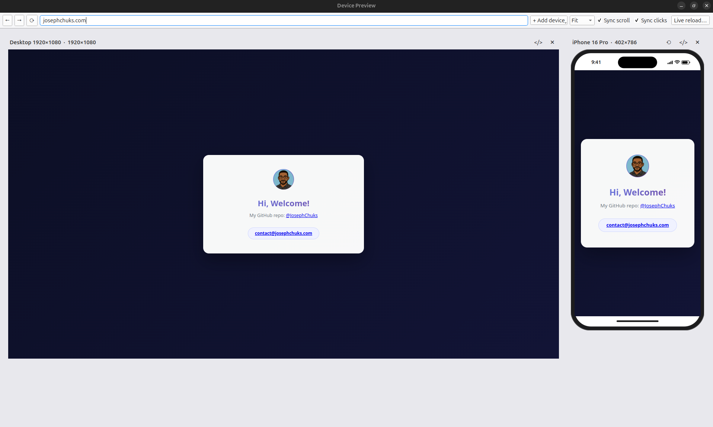

# Device Preview

Device Preview is a responsive website preview tool and an alternative to the Blisk browser. Preview a site on multiple devices at once, with an optional live reload (hot reload) feature that updates previews as you work.



## Features

- Preview multiple device sizes simultaneously, side by side. Add or remove devices at any time.
- Realistic device frames: iPhone (Dynamic Island), iPhone SE (home button), Samsung and Pixel (punch-hole camera), and iPad. Desktop views are shown as a plain browser viewport.
- Each device identifies itself as that device. Websites see the matching User-Agent, client hints (`Sec-CH-UA-*`), `navigator.platform`, touch support and pixel ratio, so server-side and JavaScript device detection behave as they would on the real device.
- Enable live reload (hot reload) to see changes without manually refreshing.
- Sync scroll and sync clicks keep every device on the same page and position as you browse.
- Rotate phones and tablets between portrait and landscape.
- Chrome DevTools for each device.
- Fit mode scales and centres all devices to fit the window.
- Address bar loading indicator, with a stop button while pages load.
- Each device type keeps its own cookies and logins between sessions.
- Your devices, URL and settings are remembered between launches.

## Installation

Requires Python 3.10+ (developed with Python 3.12 on Ubuntu 24.04).

```bash
git clone https://github.com/JosephChuks/device-preview device-preview
cd device-preview
python3 -m venv .venv
.venv/bin/pip install -r requirements.txt
```

PySide6 includes the Chromium-based Qt WebEngine, so it is a large download (around 250 MB).

On Debian/Ubuntu, if `python3 -m venv` fails with _"ensurepip is not available"_, install the venv package first:

```bash
sudo apt install python3-venv
```

## Usage

```bash
.venv/bin/python main.py
```

1. Type an address in the URL bar and press **Enter**. It loads on every device. You can enter a full URL, `localhost:8000`, or a path to a local HTML file.
2. Use **+ Add device** to add more devices, and the **✕** on a device to remove it.
3. Click **Live reload…** and choose your project folder. Every device reloads whenever you save a file in it. Click again to stop.

### Toolbar

| Control                      | What it does                                                                            |
| ---------------------------- | --------------------------------------------------------------------------------------- |
| ← →                          | Back / forward on every device                                                          |
| ⟳ / ✕                        | Reload every device; becomes **Stop** while pages are loading                           |
| + Add device                 | Add a desktop, phone or tablet                                                          |
| Fit / 100% / 75% / 50% / 33% | Device size. **Fit** sizes all devices to fit the window and centres them               |
| Sync scroll                  | Scrolling one device scrolls the others to the same relative position                   |
| Sync clicks                  | Clicking a link on one device opens it on all of them (form submissions are not copied) |
| Live reload…                 | Reload all devices when files in a folder change                                        |

Each device also has its own buttons: **⟲** rotate, **&lt;/&gt;** DevTools, **✕** remove.

### Keyboard shortcuts

| Shortcut      | Action                                  |
| ------------- | --------------------------------------- |
| Ctrl+L        | Focus the URL bar                       |
| F5 / Ctrl+R   | Reload all devices                      |
| Ctrl+Shift+R  | Reload all devices, bypassing the cache |
| Alt+← / Alt+→ | Back / forward                          |

## Devices

| Device                                  | Viewport (CSS px) | Identifies as                                           |
| --------------------------------------- | ----------------- | ------------------------------------------------------- |
| Desktop 1440×900 / 1920×1080 / 1366×768 | Full screen       | Chrome on Windows                                       |
| iPhone 16 Pro                           | 402 × 786         | Safari on iOS                                           |
| iPhone SE                               | 375 × 647         | Safari on iOS                                           |
| Samsung Galaxy S24                      | 360 × 726         | Samsung Internet on Android                             |
| Google Pixel 8                          | 412 × 859         | Chrome on Android                                       |
| iPad (10th gen)                         | 820 × 1136        | Safari on iPadOS (reports as a Mac, like the real iPad) |

Phone viewports exclude the status bar and home indicator, as on the real device. Devices are defined in `devices.py`, and new ones can be added there.

Local development servers using self-signed certificates (`localhost`, `127.0.0.1`, `*.test`, `*.local`) are accepted automatically.

## Limitations

- All devices render with Chromium. Layout, breakpoints and device detection match the real devices, but Safari-specific rendering differences on iPhone and iPad will not appear. Test on a real device for those.
- Input is mouse and keyboard, so touch-only gestures (swipe, pinch) cannot be tested.
- CSS `(hover)` and `(pointer)` media queries use the computer's real input. Only their JavaScript equivalents (`matchMedia`) report touch.

## Project structure

| File         | Purpose                                                        |
| ------------ | -------------------------------------------------------------- |
| `main.py`    | Main window, device panels, URL bar, syncing and settings      |
| `devices.py` | Device presets and the script that makes pages see each device |
| `frame.py`   | Draws the phone, tablet and desktop frames                     |
| `watcher.py` | Watches a folder for changes for live reload                   |
